<h1 align="center">FFB Base Differential</h1>

<p align="center">
  <b>Une base de joystick à retour de force open source, imprimée en 3D, construite autour d'un différentiel à engrenages coniques.</b><br>
  Deux moteurs BLDC · contrôleur ODrive v3.6 · capteurs absolus AS5048A · impression en PLA
</p>

<p align="center">
  
  
  
  
  
</p>

<p align="center">
  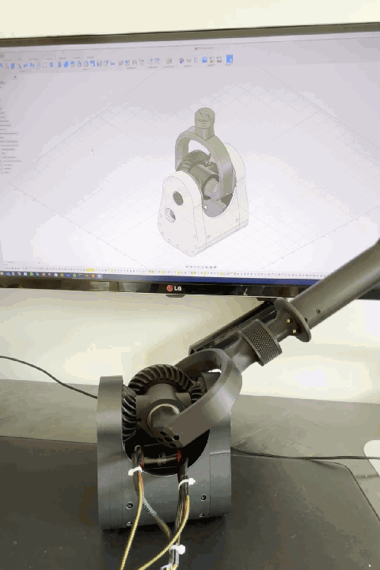
  &nbsp;
  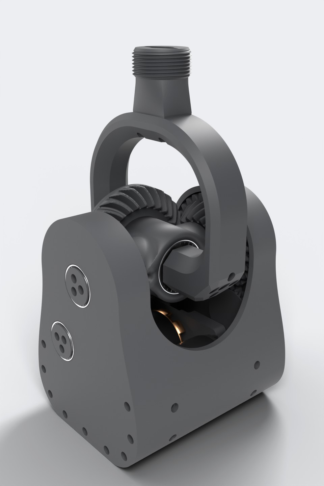
</p>

<p align="center">
  <a href="https://makerworld.com/fr/models/2220275-ffb-base-differential"></a>
  <a href="https://www.printables.com/model/1378606-ffb-base-differential"></a>
  <a href="https://www.thingiverse.com/thing:7112820"></a>
</p>

<p align="center">
  <a href="README.md">🇬🇧 English version</a> ·
  <a href="#-liste-des-composants">Liste des composants</a> ·
  <a href="#-guide-de-montage">Guide de montage</a> ·
  <a href="hardware/stl">Les STL sur GitHub</a>
</p>

---

## Sommaire

- [Points forts](#-points-forts)
- [État du projet](#-état-du-projet)
- [Fonctionnement](#%EF%B8%8F-fonctionnement)
- [Caractéristiques](#-caractéristiques)
- [Liste des composants](#-liste-des-composants)
- [Impression](#%EF%B8%8F-impression)
- [Guide de montage](#-guide-de-montage)
- [Électronique et configuration ODrive](#-électronique-et-configuration-odrive)
- [Organisation du dépôt](#-organisation-du-dépôt)
- [Historique](#%EF%B8%8F-historique)
- [Contribuer](#-contribuer)
- [Licence](#-licence)

## ✨ Points forts

- **Entraînement différentiel.** Les deux moteurs restent fixes dans la base, et **les deux moteurs agissent sur les deux axes**. Chaque axe peut profiter du couple de deux moteurs, et les pièces mobiles restent légères.
- **Engrenages imprimés.** Engrenages coniques à denture spirale (20 dents / 60 dents) et un train d'engrenages 2:1 (15 → 15 → 30 dents), tout en PLA.
- **Position absolue.** Un capteur magnétique AS5048A 14 bits sur chaque moteur, lu en SPI par le contrôleur.
- **Électronique du commerce.** 2 moteurs BLDC 5065 140 KV et une carte MKS XDrive à 2 axes (compatible ODrive v3.6).
- **Roulements standards.** 12 × 6704 et 2 × 6805, plus des vis M3. Aucune pièce usinée.
- **Modifiable.** L'assemblage CAO complet (STEP) est fourni.

## 🚧 État du projet

> [!IMPORTANT]
> **La mécanique et la commande des moteurs fonctionnent. La partie PC n'est pas encore faite.**
> La base tient et déplace le manche en asservissement de position (voir le GIF ci-dessus). Elle
> n'apparaît **pas encore** comme une manette USB : elle ne peut donc pas recevoir les effets de force
> d'un simulateur de vol (MSFS, DCS, X-Plane, IL-2…) sans développement supplémentaire.

- [x] Mécanisme différentiel conçu, imprimé et assemblé
- [x] Commande en boucle fermée des deux BLDC sur l'ODrive avec les capteurs absolus AS5048A
- [ ] Réglage du mode couple (`torque_constant`, gains)
- [ ] Interface USB HID à retour de force (DirectInput / PID) avec le mixage différentiel
- [ ] Schéma de câblage et photos de montage

Les idées et contributions côté firmware sont les bienvenues. Voir [Contribuer](#-contribuer).

## ⚙️ Fonctionnement

<p align="center">
  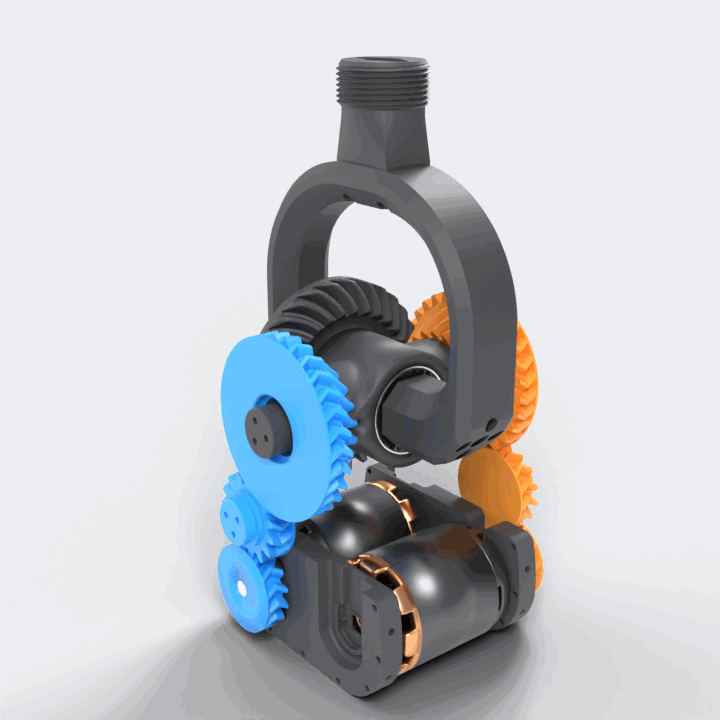
</p>

Chaque moteur entraîne un **engrenage conique latéral** par un pignon de 15 dents, un pignon
intermédiaire de 15 dents et une couronne de 30 dents (train orange d'un côté, train bleu de
l'autre). Les deux engrenages latéraux engrènent sur l'**engrenage central de 60 dents** qui porte le
grip :

- **Tangage :** quand les deux engrenages latéraux tournent **dans le même sens**, tout le porte-satellite bascule autour de l'axe des flancs.
- **Roulis :** quand ils tournent **en sens opposé**, l'engrenage central tourne sur lui-même et incline le porte-grip sur le côté.

| | Tangage (axe du porte-satellite) | Roulis (axe de l'engrenage central) |
|---|---|---|
| Tours moteur par tour de manche | 2 | 6 |
| Angle du manche selon les angles moteurs | (θ₁ + θ₂) / 4 | (θ₁ − θ₂) / 12 |
| Couple au manche selon les couples moteurs | 2 · (τ₁ + τ₂) | 6 · (τ₁ − τ₂) |

Les calculs, les conventions de signe et le mixage des couples nécessaire au retour de force sont
détaillés dans [docs/how-it-works.md](docs/how-it-works.md) (en anglais).

<p align="center">
  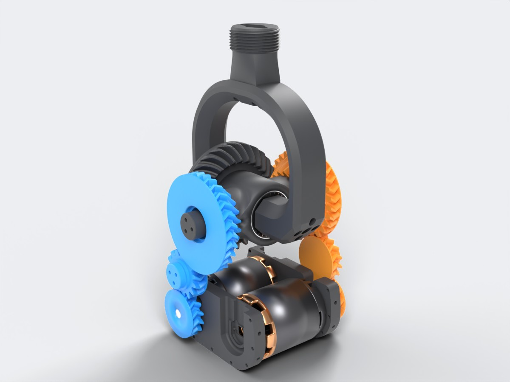
</p>

## 📐 Caractéristiques

| | |
|---|---|
| Degrés de liberté | 2 (tangage + roulis) |
| Mécanisme | Différentiel à engrenages coniques spirale, moteurs fixes dans la base |
| Réduction | 2:1 en tangage, 6:1 en roulis (tours moteur par tour de manche) |
| Moteurs | 2 × BLDC 5065 140 KV (7 paires de pôles, Kt ≈ 0,059 N·m/A) |
| Contrôleur | MKS XDrive (compatible ODrive v3.6, firmware 0.5.x), 2 axes |
| Capteurs | 2 × AS5048A, capteurs magnétiques 14 bits (SPI), un par moteur |
| Couple max théorique au manche* | ≈ 1,9 N·m en tangage · ≈ 5,7 N·m en roulis |
| Résolution au manche | ≈ 0,011° en tangage · ≈ 0,004° en roulis |
| Encombrement au sol | 113 × 136 mm |
| Hauteur | 154 mm (boîtier) · 247 mm jusqu'au haut de l'adaptateur de grip |
| Hauteur du pivot | 112 mm au-dessus du bureau |
| Pièces imprimées | 14 fichiers STL, 25 pièces, PLA |

<sub>* Les deux moteurs à la limite de 8 A de la configuration ODrive fournie, engrenages idéaux (sans pertes par frottement).</sub>

## 🧾 Liste des composants

### Pièces imprimées (14 fichiers, 25 pièces)

La quantité figure dans le nom de chaque fichier (`_x2` signifie l'imprimer deux fois). Les mêmes
fichiers sont sur [MakerWorld](https://makerworld.com/fr/models/2220275-ffb-base-differential),
[Printables](https://www.printables.com/model/1378606-ffb-base-differential) et
[Thingiverse](https://www.thingiverse.com/thing:7112820).

| | Fichier | Qté | Rôle |
|:-:|---|:-:|---|
| 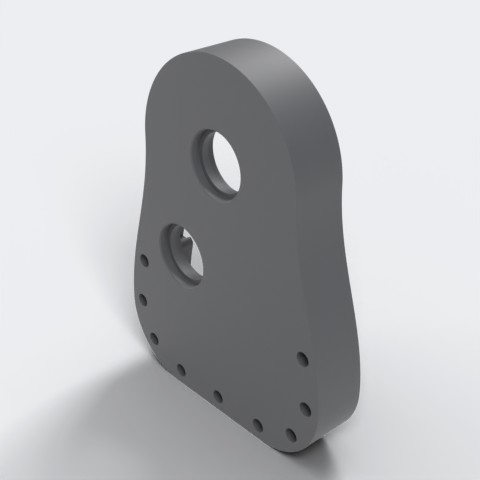 | [`Side_Panel_x2.stl`](hardware/stl/Side_Panel_x2.stl) | 2 | Flanc du boîtier. Reçoit 4 roulements 6704 (axe du porte-satellite + pignon intermédiaire) |
| 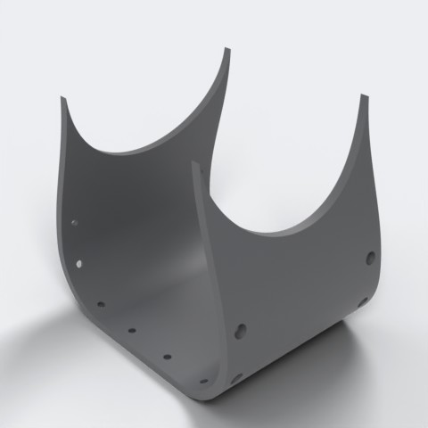 | [`Bottom_Panel_x1.stl`](hardware/stl/Bottom_Panel_x1.stl) | 1 | Corps du boîtier (fond, avant et arrière) |
| 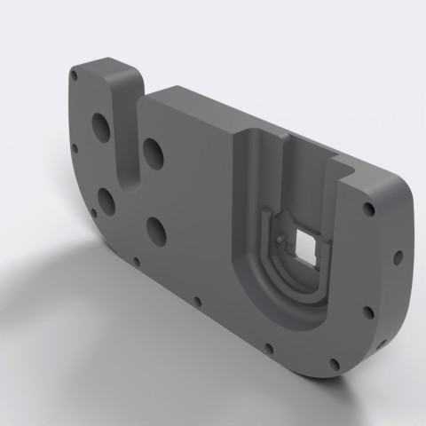 | [`Motor_Support_x2.stl`](hardware/stl/Motor_Support_x2.stl) | 2 | Support moteur avec logement pour la carte AS5048A |
| 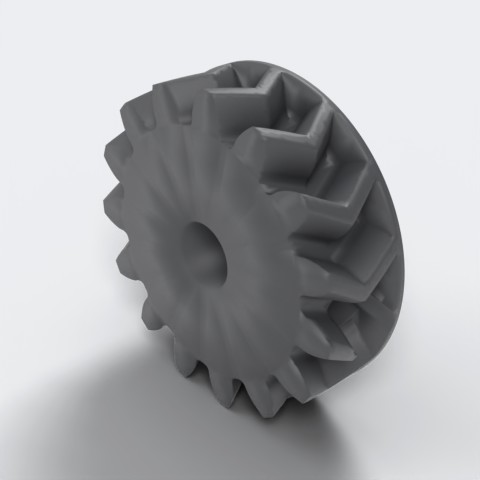 | [`Motor_Gear_x2.stl`](hardware/stl/Motor_Gear_x2.stl) | 2 | Pignon de 15 dents sur l'arbre moteur |
| 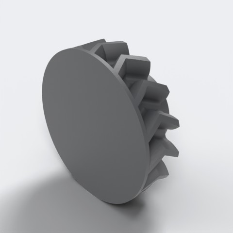 | [`Transmission_Gear_x2.stl`](hardware/stl/Transmission_Gear_x2.stl) | 2 | Pignon intermédiaire de 15 dents |
| 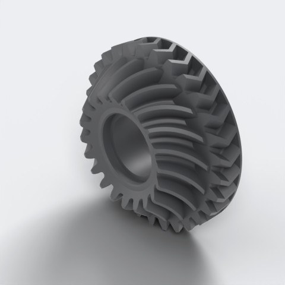 | [`Small_Gear_x2.stl`](hardware/stl/Small_Gear_x2.stl) | 2 | Engrenage latéral : couronne de 30 dents + conique spirale de 20 dents |
| 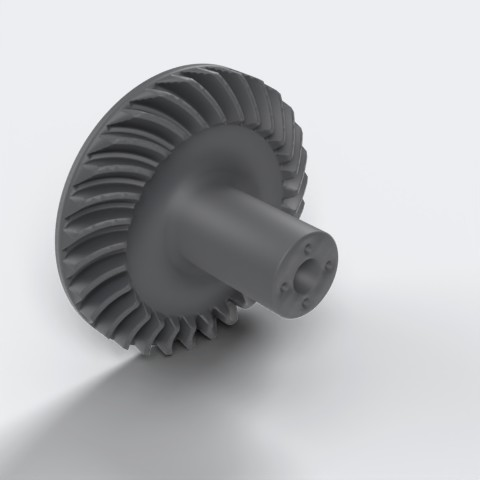 | [`Big_Gear_x1.stl`](hardware/stl/Big_Gear_x1.stl) | 1 | Engrenage central conique spirale de 60 dents (sortie roulis) |
| 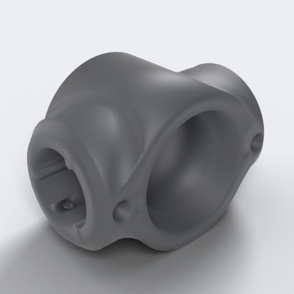 | [`Gear_Hub_x1.stl`](hardware/stl/Gear_Hub_x1.stl) | 1 | Porte-satellite (tangage). Reçoit 2 roulements 6805 |
| 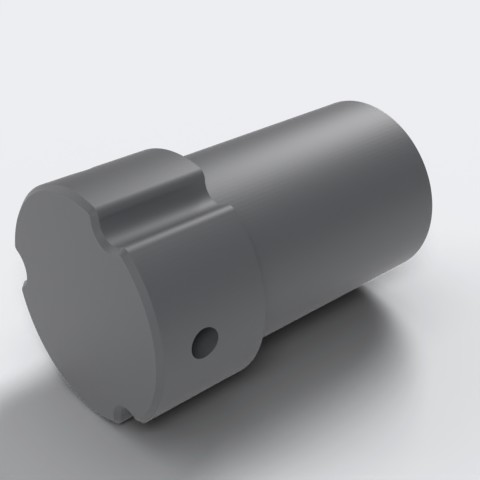 | [`Hub_Axis_x2.stl`](hardware/stl/Hub_Axis_x2.stl) | 2 | Axes du porte-satellite (axe de tangage) |
| 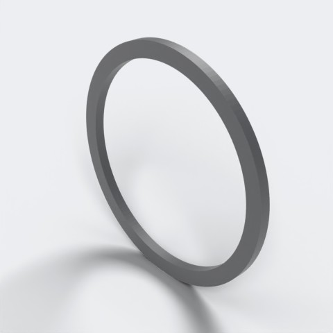 | [`Hub_Spacer_x2.stl`](hardware/stl/Hub_Spacer_x2.stl) | 2 | Entretoise de 1 mm entre un engrenage latéral et un flanc |
| 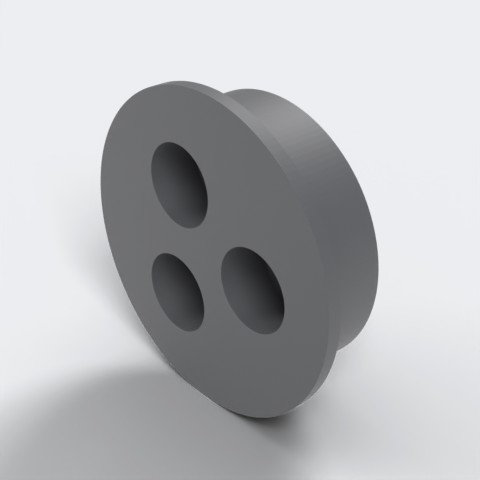 | [`Axis_Cap_x4.stl`](hardware/stl/Axis_Cap_x4.stl) | 4 | Capuchons de roulement extérieurs sur les flancs |
| 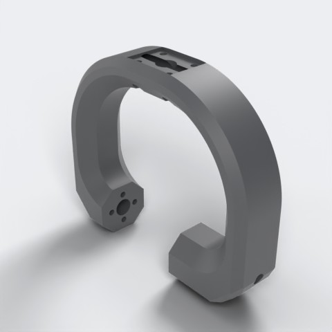 | [`Grip_Holder_P2_x1.stl`](hardware/stl/Grip_Holder_P2_x1.stl) | 1 | Chape en U fixée à l'engrenage central |
| 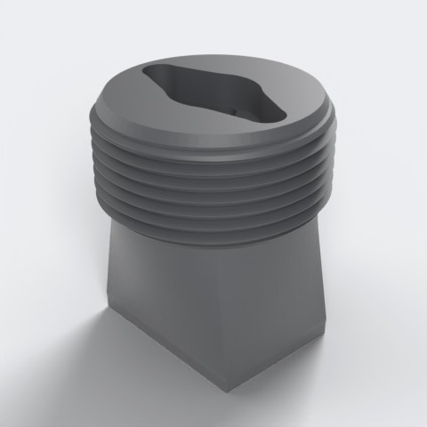 | [`Grip_Holder_P1_x1.stl`](hardware/stl/Grip_Holder_P1_x1.stl) | 1 | Adaptateur fileté pour le grip |
| 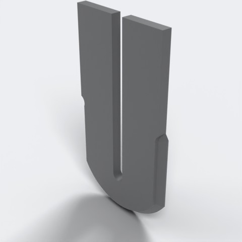 | [`AS5048A_Cap_x2.stl`](hardware/stl/AS5048A_Cap_x2.stl) | 2 | Capot de la carte capteur |

### Quincaillerie

| Article | Qté | Emplacement | Lien |
|---|:-:|---|---|
| Roulement **6704** (20 × 27 × 4 mm) | 12 | 4 par flanc, 2 par engrenage latéral | [Amazon](https://amzn.to/46OaAmP) |
| Roulement **6805** (25 × 37 × 7 mm) | 2 | Porte-satellite (axe de roulis) | [Amazon](https://amzn.to/3H3fCBD) |
| Vis M3 autotaraudeuses (pour plastique), longueurs assorties | 1 kit | Boîtier, capuchons, chape | [Amazon](https://amzn.to/45HISak) |
| Filament PLA | ≈ 1 kg | Toutes les pièces imprimées | [Amazon](https://amzn.to/4loAYaD) |

### Électronique

| Article | Qté | Remarques | Lien |
|---|:-:|---|---|
| Moteur BLDC **5065 140 KV** | 2 | Outrunner, arbre de 8 mm | [Amazon](https://amzn.to/3Hg6zxa) |
| **MKS XDrive** (compatible ODrive v3.6) | 1 | Contrôleur BLDC 2 axes | [Amazon](https://amzn.to/456QqmO) |
| Carte capteur magnétique **AS5048A** (SPI) | 2 | Généralement vendue avec un aimant diamétral | |
| Aimant à aimantation diamétrale (6 × 2,5 mm) | 2 | Collé au bout arrière de chaque arbre moteur | |
| Résistance de freinage (2 Ω) | 1 | Absorbe l'énergie quand on pousse le manche | |
| Alimentation continue | 1 | Adaptée à la tension de ta carte | |
| Grip | 1 | Tout grip compatible avec l'adaptateur fileté | |

<sub>Certains liens ci-dessus sont des liens affiliés. Ils ne te coûtent rien et soutiennent le projet.</sub>

## 🖨️ Impression

Réglages de départ conseillés (à adapter à ton imprimante) :

| | Pièces du boîtier (flancs, supports, capuchons) | Engrenages, moyeu, axes, chape |
|---|---|---|
| Matière | PLA | PLA (le PETG convient aussi) |
| Hauteur de couche | 0,2 mm | 0,12 à 0,16 mm pour des dents plus lisses |
| Parois | 3 | 4 ou plus |
| Remplissage | 20 à 30 % | 50 à 100 % |

Avant le montage, vérifie les logements de roulements : les roulements doivent entrer en force mais
sans excès. Si un logement est trop serré, ajuste la compensation horizontale de ton trancheur plutôt
que de forcer.

## 🔧 Guide de montage

<p align="center">
  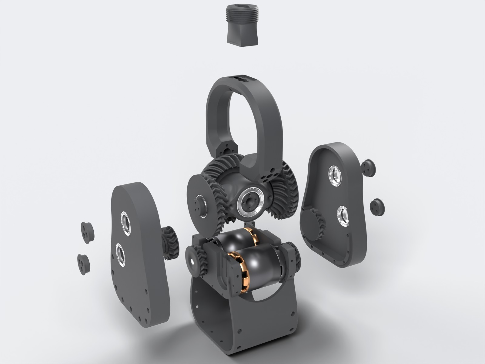
</p>

Sur les images ci-dessous, les pièces imprimées ajoutées à chaque étape sont en **orange**. Les roulements apparaissent en acier.

### Étape 1 : flancs

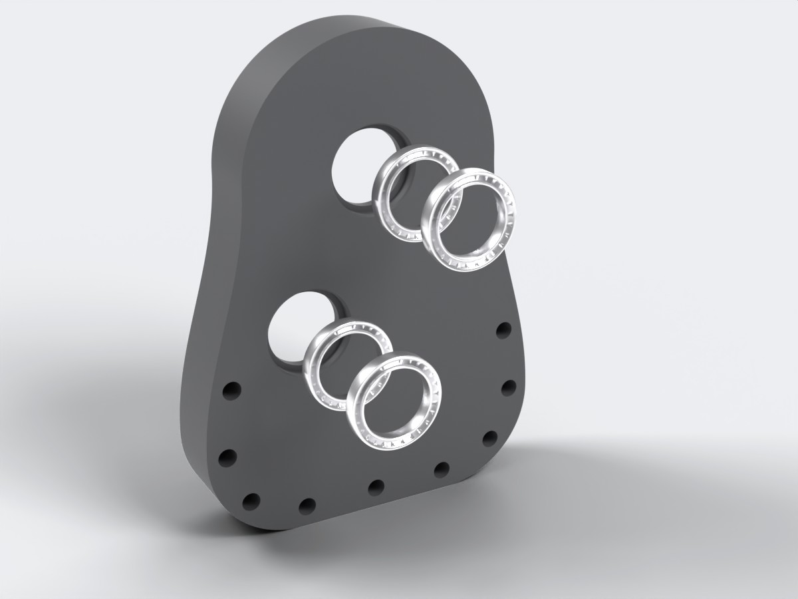

- Enfonce **2 roulements 6704** dans l'alésage du haut (axe du porte-satellite) et **2 roulements 6704** dans l'alésage du bas (pignon intermédiaire).
- Recommence avec le second flanc. Cela fait 8 roulements au total.

### Étape 2 : engrenages latéraux

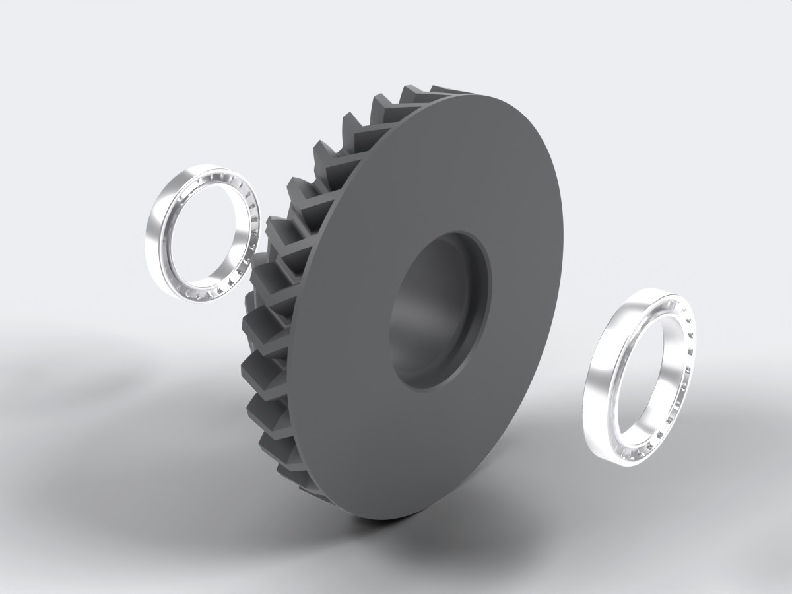

- Enfonce un roulement **6704** dans chaque face d'un `Small_Gear` (2 par engrenage).
- Recommence avec le second engrenage latéral. Cela fait 4 roulements au total.

### Étape 3 : cœur du différentiel

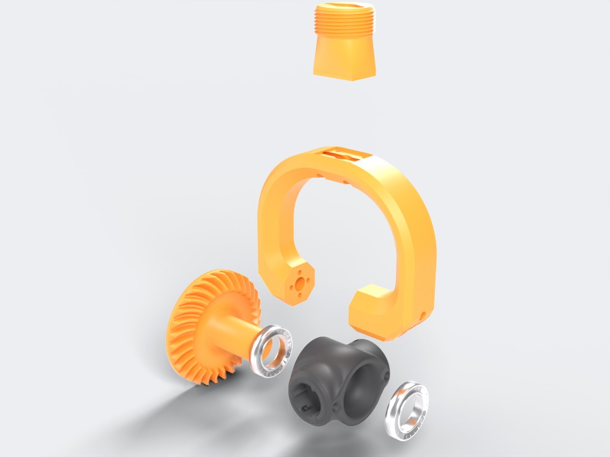

- Enfonce les **2 roulements 6805** dans le `Gear_Hub`.
- Glisse l'arbre du `Big_Gear` (engrenage central de 60 dents) dans un des roulements.
- Mets en place la chape `Grip_Holder_P2` : une extrémité entre dans l'autre roulement, l'autre se visse au dos de l'engrenage central.
- Visse l'adaptateur `Grip_Holder_P1` en haut de la chape.

### Étape 4 : axes du porte-satellite et engrenages latéraux

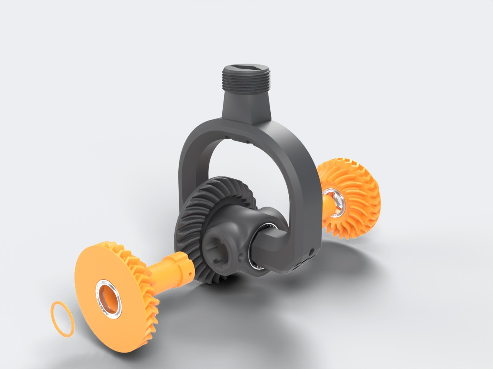

- Enfonce les deux axes `Hub_Axis` de chaque côté du `Gear_Hub`.
- Enfile un engrenage latéral sur chaque axe, denture conique tournée vers l'engrenage central, puis une `Hub_Spacer`.

### Étape 5 : bloc moteurs

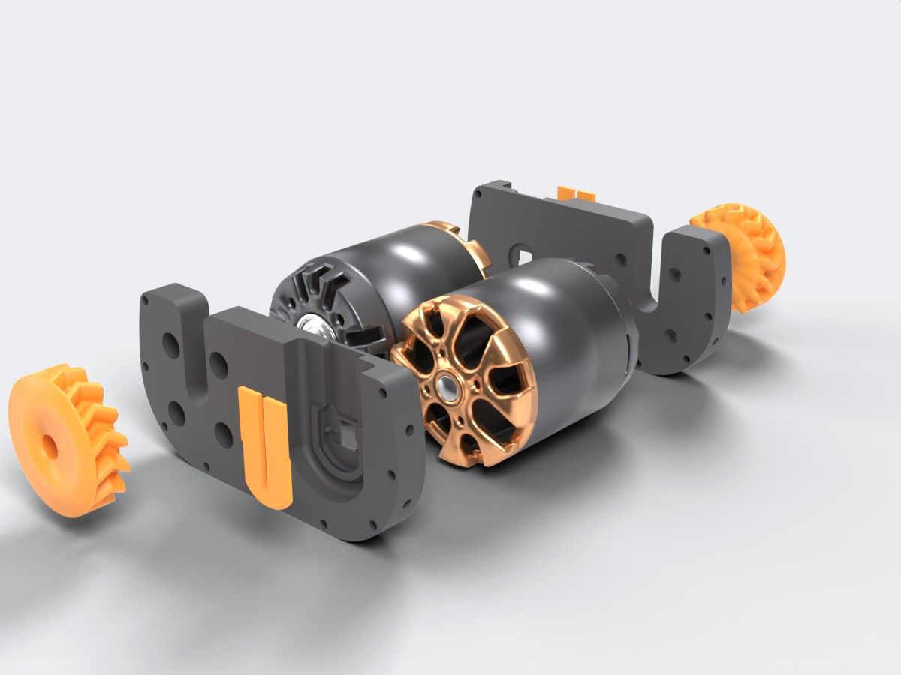

- Les deux moteurs sont côte à côte, tête-bêche. Visse chaque moteur sur le `Motor_Support` situé du côté de sa sortie d'arbre.
- Emmanche un `Motor_Gear` sur chaque arbre moteur, à l'extérieur du support.
- Colle un aimant diamétral au bout **arrière** de chaque arbre moteur.
- Place chaque carte AS5048A dans le logement du support opposé, face à l'aimant, et ferme avec un `AS5048A_Cap`.

### Étape 6 : corps du boîtier

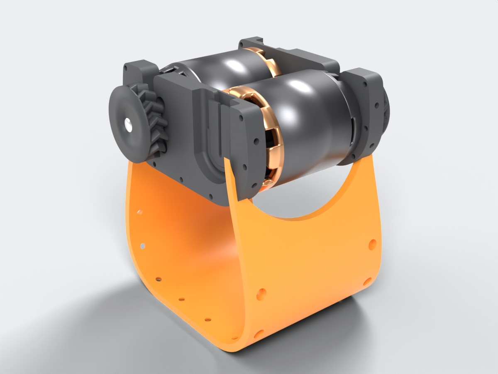

- Descends le bloc moteurs dans le `Bottom_Panel` et visse les deux supports.
- Fais sortir les fils de phase des moteurs et les câbles des capteurs avant de fermer.

### Étape 7 : fermeture du boîtier

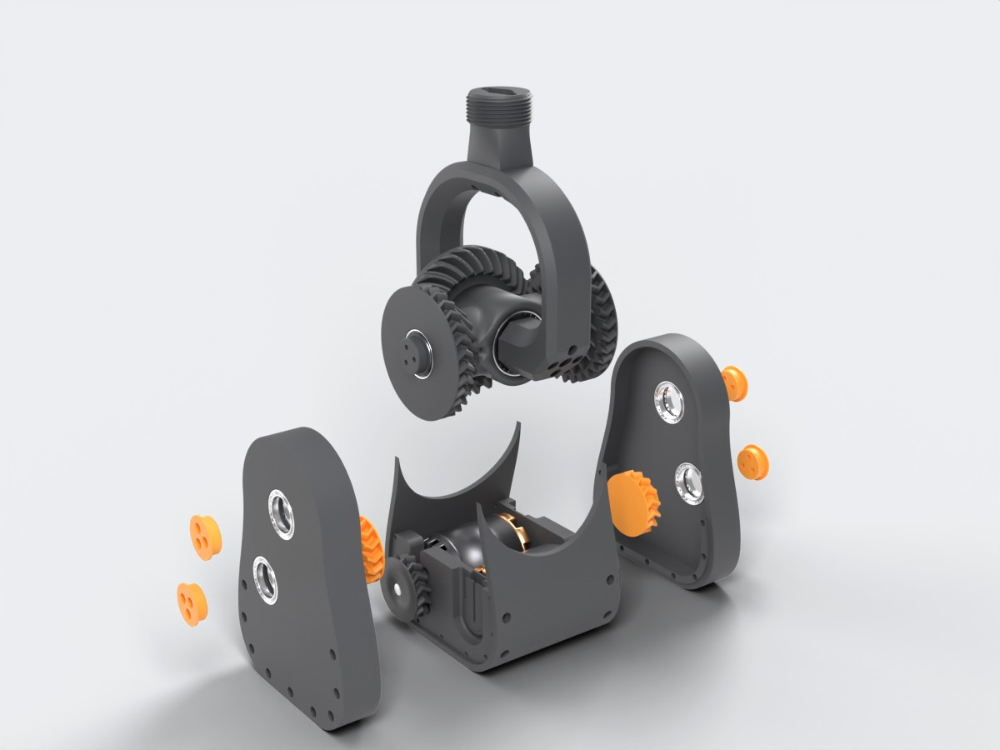

- Descends le cœur du différentiel dans le boîtier.
- Mets en place chaque `Transmission_Gear` (pignon intermédiaire) pour qu'il engrène à la fois sur le pignon moteur et sur la couronne de l'engrenage latéral.
- Ferme avec les deux flancs : les axes du porte-satellite et les moyeux des pignons intermédiaires entrent dans les roulements des flancs.
- Pose les quatre `Axis_Cap` par l'extérieur et fixe chacun avec 3 vis. Visse ensuite les flancs sur le corps du boîtier.
- Vérifie que le manche bouge librement sur les deux axes avant de mettre sous tension.

### Étape 8 : câblage, configuration et grip

- Branche les moteurs, les capteurs, la résistance de freinage et l'alimentation (voir la section suivante).
- Configure et calibre l'ODrive.
- Visse ton grip sur l'adaptateur.

<p align="center">
  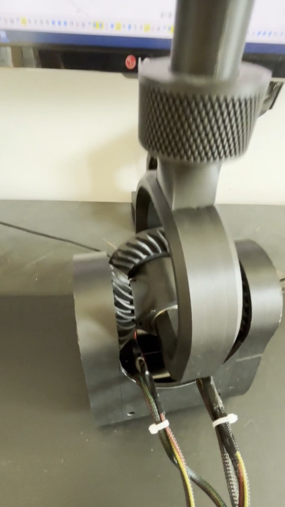
  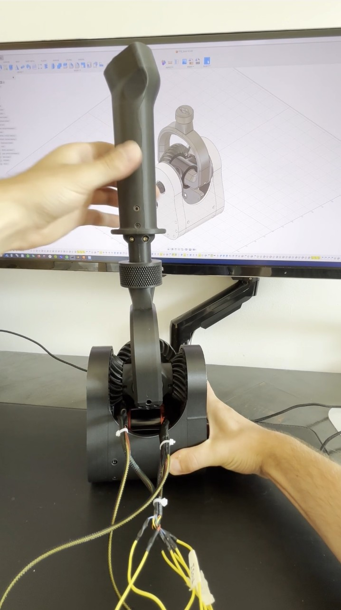
  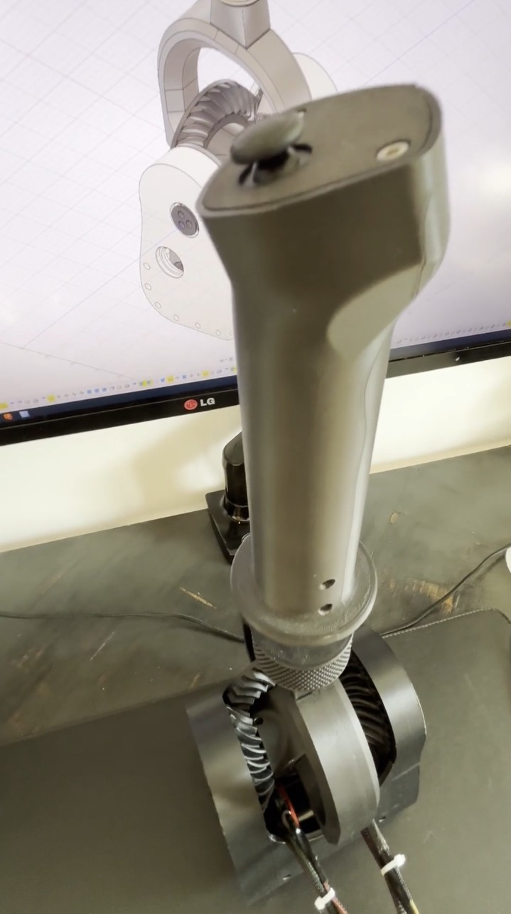
</p>

## 🔌 Électronique et configuration ODrive

| Depuis | Vers (MKS XDrive / ODrive v3.6) |
|---|---|
| Phases du moteur A | M0 |
| Phases du moteur B | M1 |
| Capteur A : VDD 3,3 V, GND, CLK, MISO, MOSI | 3,3 V, GND, SCK, MISO, MOSI |
| Capteur A : CSn | GPIO 8 (axe 0) |
| Capteur B : même bus, CSn | GPIO 7 (axe 1) |
| Résistance de freinage | AUX |
| Alimentation | Entrée DC |

La configuration est une liste de commandes `odrivetool` :
[`firmware/odrive/odrive_config_as5048a.txt`](firmware/odrive/odrive_config_as5048a.txt).
Le détail (chaque paramètre, l'ordre des calibrations, des conseils pour le mode couple) est dans
[docs/electronics-and-odrive.md](docs/electronics-and-odrive.md) (en anglais).

## 📁 Organisation du dépôt

```
├── hardware/
│   ├── stl/            14 pièces à imprimer (quantité dans le nom de fichier)
│   └── step/           assemblage CAO complet (STEP, stocké avec Git LFS)
├── firmware/
│   └── odrive/         configuration ODrive (commandes odrivetool)
└── docs/
    ├── how-it-works.md
    ├── electronics-and-odrive.md
    └── images/         rendus, GIF, photos, vignettes des pièces
```

Le fichier STEP est stocké avec [Git LFS](https://git-lfs.com/). Lance `git lfs install` avant de
cloner, ou télécharge-le depuis l'interface web de GitHub.

## 🕰️ Historique

1. **V1 (début 2025) :** moteurs gimbal GBM5208, contrôleurs Spectral Micro BLDC et transmission par courroies HTD 3M.
2. **Essais pas-à-pas (printemps 2025) :** FOC sur moteurs pas-à-pas avec SimpleFOC (ESP32, Teensy 4.0), drivers TMC2209 / TMC5160 et un MKS SERVO42C, pour rendre les moteurs pas-à-pas réversibles.
3. **V2 (été 2025, version actuelle) :** moteurs BLDC 5065, contrôleur compatible ODrive, engrenages coniques spirale imprimés et capteurs absolus AS5048A.

## 🤝 Contribuer

Les issues et pull requests sont les bienvenues, en particulier sur :

- le firmware USB HID à retour de force et le mixage différentiel ;
- les retours sur l'impression et le montage ;
- les photos de vos montages.

## 📜 Licence

- **Matériel** (STL, STEP, images et documentation) :
  [CC BY-NC-SA 4.0](https://creativecommons.org/licenses/by-nc-sa/4.0/deed.fr). Tu peux le partager
  et le modifier pour un usage non commercial, en citant le projet et sous la même licence. Voir [LICENSE](LICENSE).
- **Code et configuration** (`firmware/`) : [MIT](firmware/LICENSE).
