<h1 align="center">FFB Base Differential</h1>

  <b>An open-source, 3D-printed force feedback joystick base built around a bevel-gear differential.</b> 
  Two BLDC motors · ODrive v3.6 controller · AS5048A absolute encoders · printed in PLA

  
  
  
  
  

  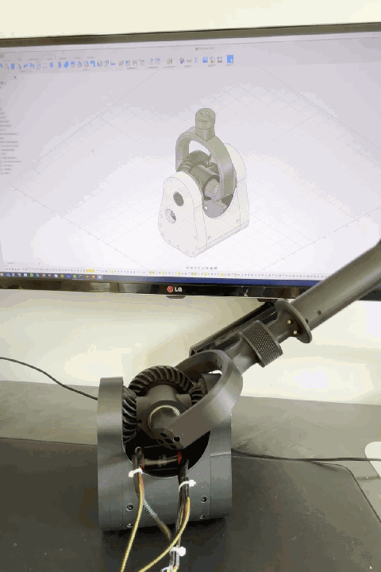
  &nbsp;
  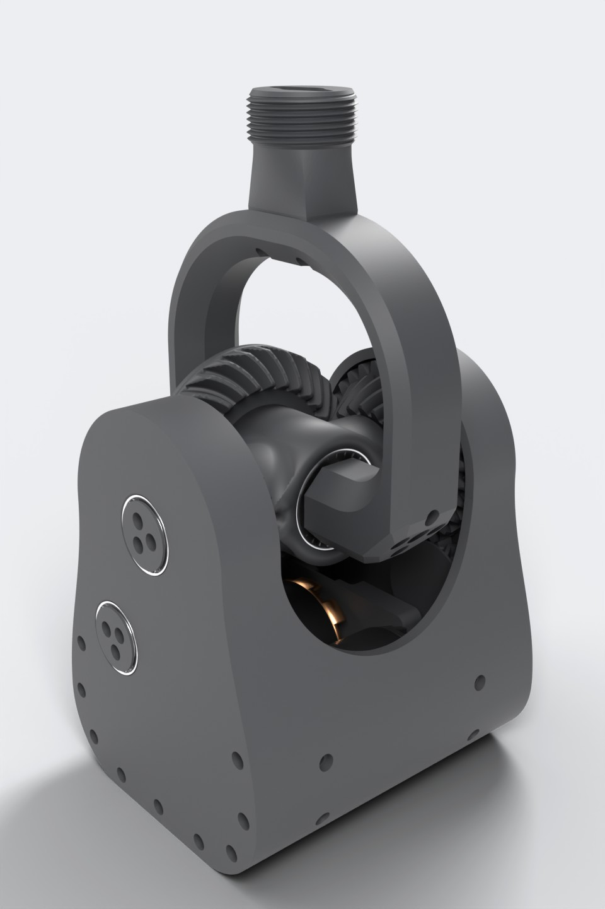

  
  
  

  <a href="#-bill-of-materials">Bill of materials</a> ·
  <a href="#-assembly-guide">Assembly guide</a> ·
  <a href="hardware/stl">STL files on GitHub</a>

---

## Table of contents

- [Highlights](#-highlights)
- [How it works](#%EF%B8%8F-how-it-works)
- [Specifications](#-specifications)
- [Bill of materials](#-bill-of-materials)
- [Assembly guide](#-assembly-guide)
- [Electronics and ODrive setup](#-electronics-and-odrive-setup)
- [License](#-license)

## ✨ Highlights

- **Differential drive.** Both motors stay fixed in the base, and **both motors work on both axes**. Each axis can use the torque of two motors, and the moving parts stay light.
- **Printed gears.** Spiral bevel gears (20T / 60T) and a 2:1 gear train (15T → 15T → 30T), all printed in PLA.
- **Absolute position sensing.** One 14-bit AS5048A magnetic encoder on each motor, read over SPI by the controller.
- **Off-the-shelf electronics.** 2 × 5065 140 KV BLDC motors and one dual-axis MKS XDrive (an ODrive v3.6-compatible board).
- **Standard bearings.** 12 × 6704 and 2 × 6805, plus M3 screws. No machined parts.
- **Remixable.** The full CAD assembly (STEP) is included.

## ⚙️ How it works

  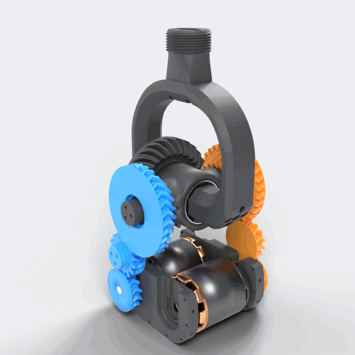
  &nbsp;
  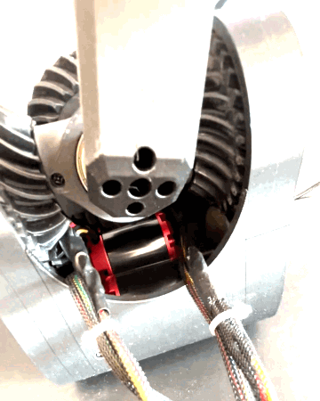

Each motor drives one **side bevel gear** through a 15T pinion, a 15T idler and a 30T ring (orange
train on one side, blue train on the other). Both side gears mesh with the **60T crown gear** that
carries the grip:

- **Pitch:** when both side gears turn **the same way**, the whole differential carrier tilts around the side-panel axis.
- **Roll:** when they turn **in opposite directions**, the crown gear spins and tilts the grip holder sideways.

| | Pitch (carrier axis) | Roll (crown axis) |
|---|---|---|
| Motor turns per stick turn | 2 | 6 |
| Stick angle from motor angles | (θ₁ + θ₂) / 4 | (θ₁ − θ₂) / 12 |
| Stick torque from motor torques | 2 · (τ₁ + τ₂) | 6 · (τ₁ − τ₂) |

The maths, sign conventions and the torque mixing needed for force feedback are in
[docs/how-it-works.md](docs/how-it-works.md).

## 📐 Specifications

| | |
|---|---|
| Axes | 2 (pitch + roll), bevel-gear differential |
| Motors | 2 × BLDC 5065 140 KV |
| Controller | MKS XDrive (ODrive v3.6 compatible) |
| Sensors | 2 × AS5048A, 14-bit, SPI |
| Reduction | 2:1 pitch · 6:1 roll |
| Peak stick torque (theoretical, 8 A) | ≈ 1.9 N·m pitch · ≈ 5.7 N·m roll |
| Size | 113 × 136 mm footprint, 247 mm tall |

## 🧾 Bill of materials

### Printed parts (14 files, 25 pieces)

The quantity is in each file name (`_x2` means print it twice). The same files are on
[MakerWorld](https://makerworld.com/fr/models/2220275-ffb-base-differential),
[Printables](https://www.printables.com/model/1378606-ffb-base-differential) and
[Thingiverse](https://www.thingiverse.com/thing:7112820).

| | File | Qty | Role |
|:-:|---|:-:|---|
| 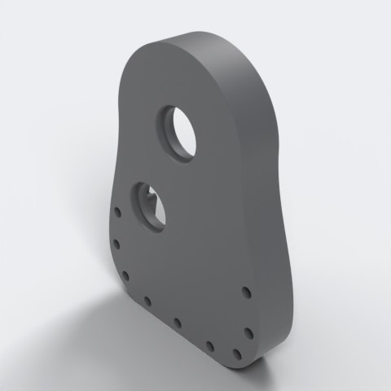 | [`Side_Panel_x2.stl`](hardware/stl/Side_Panel_x2.stl) | 2 | Case side. Holds 4 × 6704 bearings (carrier axis + idler) |
| 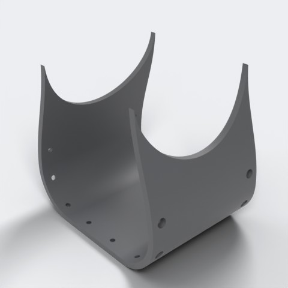 | [`Bottom_Panel_x1.stl`](hardware/stl/Bottom_Panel_x1.stl) | 1 | Case body (bottom, front and back) |
| 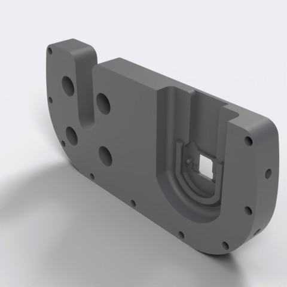 | [`Motor_Support_x2.stl`](hardware/stl/Motor_Support_x2.stl) | 2 | Motor mount with a pocket for the AS5048A board |
| 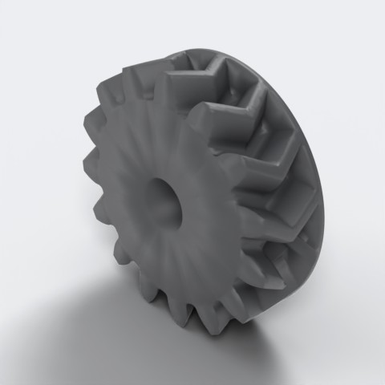 | [`Motor_Gear_x2.stl`](hardware/stl/Motor_Gear_x2.stl) | 2 | 15T pinion on the motor shaft |
| 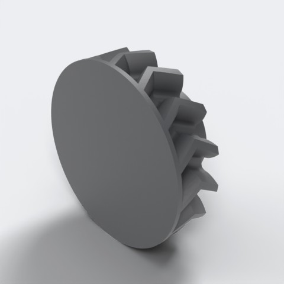 | [`Transmission_Gear_x2.stl`](hardware/stl/Transmission_Gear_x2.stl) | 2 | 15T idler gear |
| 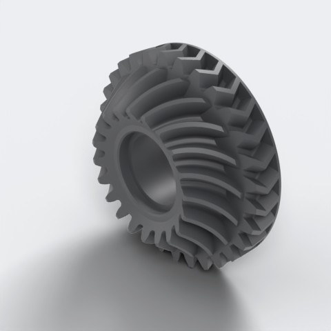 | [`Small_Gear_x2.stl`](hardware/stl/Small_Gear_x2.stl) | 2 | Side gear: 30T ring + 20T spiral bevel |
| 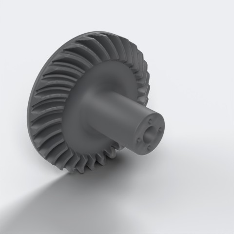 | [`Big_Gear_x1.stl`](hardware/stl/Big_Gear_x1.stl) | 1 | 60T spiral bevel crown gear (roll output) |
| 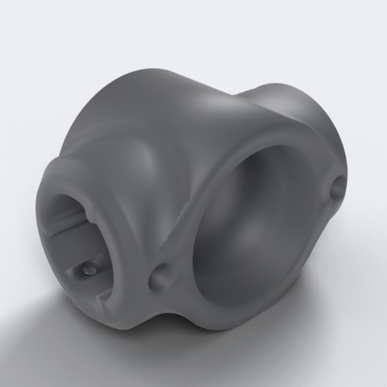 | [`Gear_Hub_x1.stl`](hardware/stl/Gear_Hub_x1.stl) | 1 | Differential carrier (pitch). Holds 2 × 6805 |
| 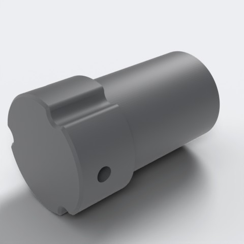 | [`Hub_Axis_x2.stl`](hardware/stl/Hub_Axis_x2.stl) | 2 | Carrier shafts (pitch axis) |
| 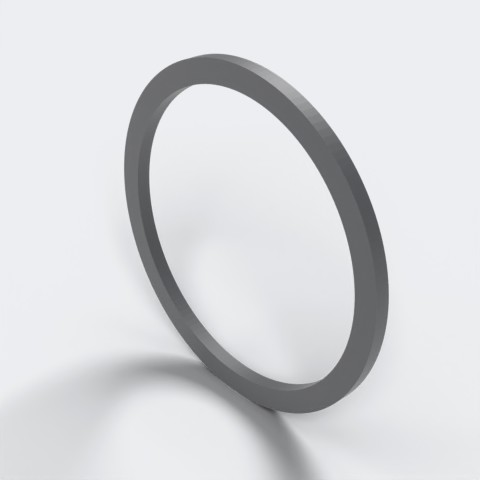 | [`Hub_Spacer_x2.stl`](hardware/stl/Hub_Spacer_x2.stl) | 2 | 1 mm spacer between a side gear and a side panel |
| 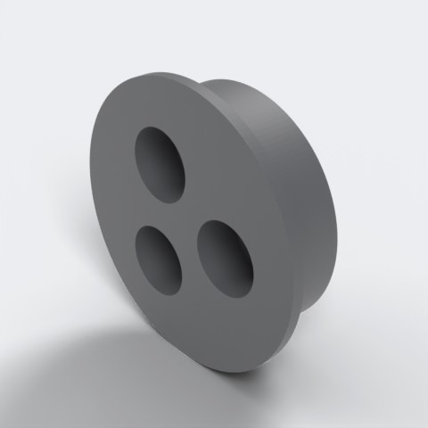 | [`Axis_Cap_x4.stl`](hardware/stl/Axis_Cap_x4.stl) | 4 | Outer bearing caps on the side panels |
| 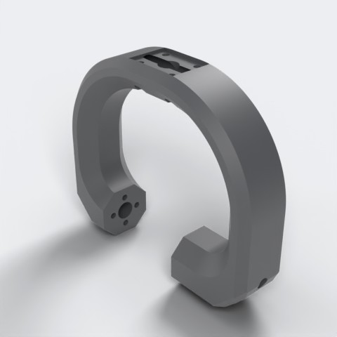 | [`Grip_Holder_P2_x1.stl`](hardware/stl/Grip_Holder_P2_x1.stl) | 1 | U-shaped yoke attached to the crown gear |
| 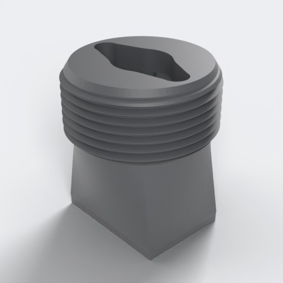 | [`Grip_Holder_P1_x1.stl`](hardware/stl/Grip_Holder_P1_x1.stl) | 1 | Threaded grip adapter |
| 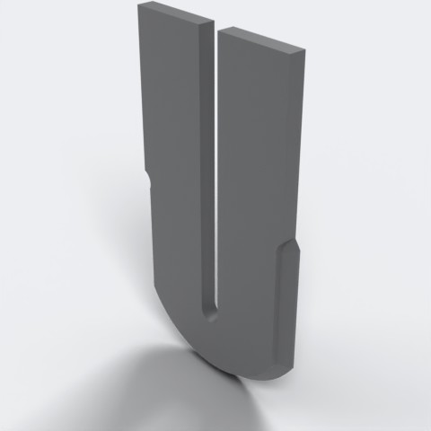 | [`AS5048A_Cap_x2.stl`](hardware/stl/AS5048A_Cap_x2.stl) | 2 | Encoder board cover |

### Mechanical hardware

| Item | Qty | Where | Link |
|---|:-:|---|---|
| Ball bearing **6704** (20 × 27 × 4 mm) | 12 | 4 per side panel, 2 per side gear | [Amazon](https://amzn.to/46OaAmP) |
| Ball bearing **6805** (25 × 37 × 7 mm) | 2 | Gear hub (roll axis) | [Amazon](https://amzn.to/3H3fCBD) |
| M3 self-tapping screws (for plastic), assorted lengths | 1 kit | Case, caps, yoke | [Amazon](https://amzn.to/45HISak) |
| PLA filament | ≈ 1 kg | All printed parts | [Amazon](https://amzn.to/4loAYaD) |

### Electronics

| Item | Qty | Notes | Link |
|---|:-:|---|---|
| BLDC motor **5065 140 KV** | 2 | Outrunner, 8 mm shaft | [Amazon](https://amzn.to/3Hg6zxa) |
| **MKS XDrive** (ODrive v3.6 compatible) | 1 | Dual-axis BLDC controller | [Amazon](https://amzn.to/456QqmO) |
| **AS5048A** magnetic encoder board (SPI) | 2 | Usually sold with a diametrically magnetized magnet | |
| Diametrically magnetized magnet (6 × 2.5 mm) | 2 | Glued on the rear end of each motor shaft | |
| Brake resistor (2 Ω) | 1 | Absorbs the energy when you push the stick | |
| DC power supply | 1 | Matching your board's voltage rating | |
| Grip | 1 | Any grip that fits the threaded adapter | |

Some links above are affiliate links. They cost you nothing and help support the project.

## 🔧 Assembly guide

  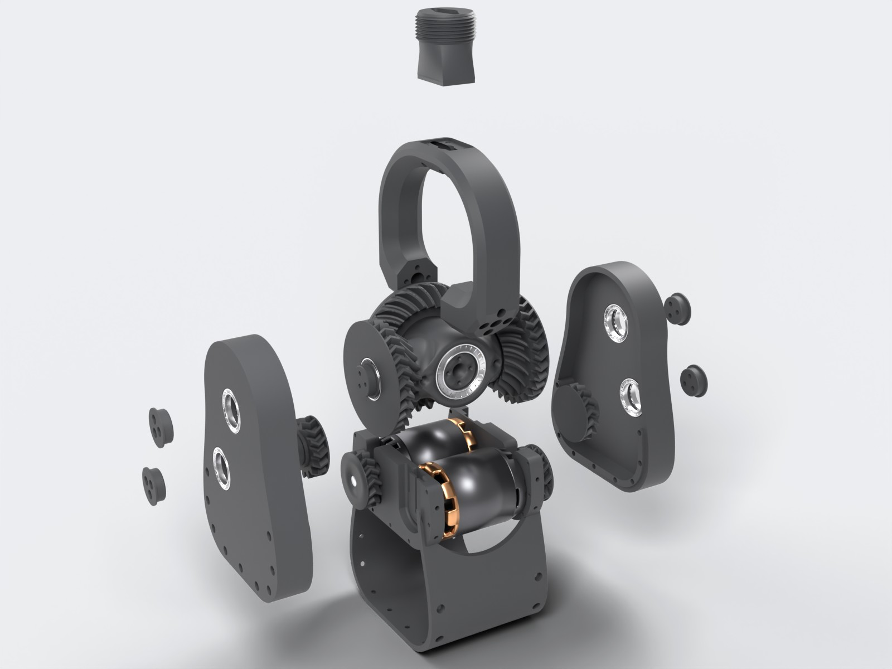

In the pictures below, **orange** marks the printed parts added at that step. Bearings are shown in steel.

### Step 1: Side panels

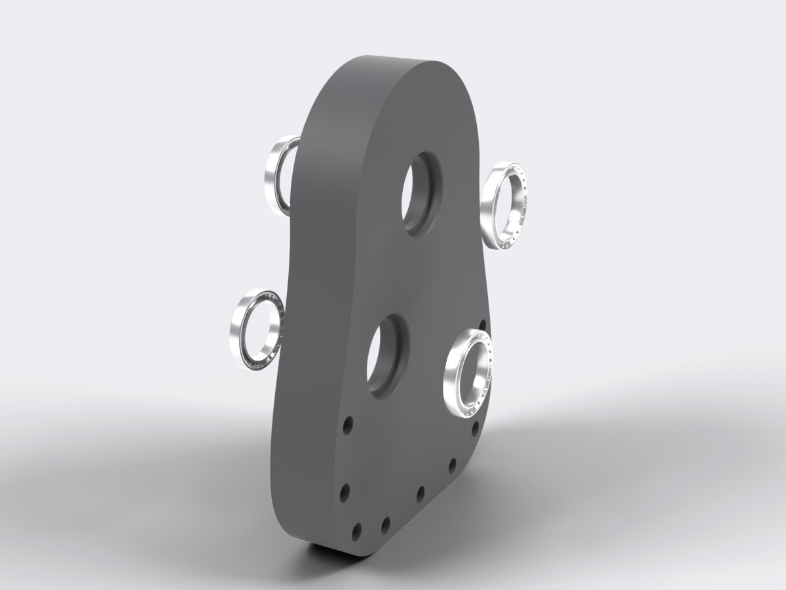

- Upper bore (carrier axis): press one **6704** bearing from the outside and one from the inside.
- Lower bore (idler gear): same, one **6704** from each side.
- Repeat with the second side panel. That uses 8 bearings in total.

### Step 2: Side gears

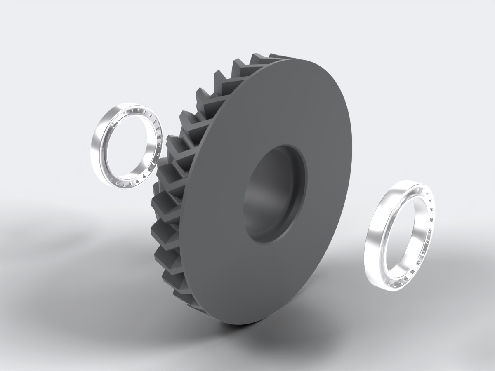

- Press one **6704** bearing into each face of a `Small_Gear` (2 per gear).
- Repeat with the second side gear. That uses 4 bearings in total.

### Step 3: Differential core

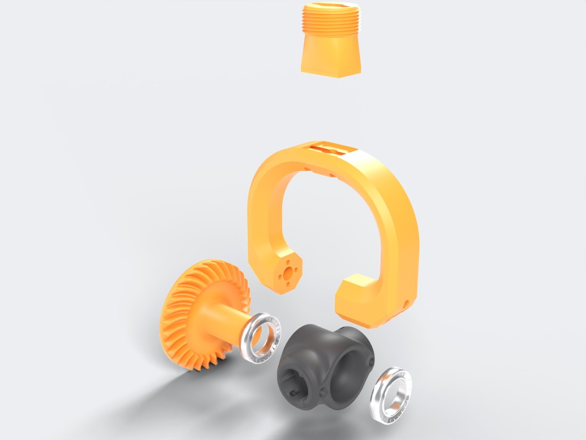

- Press the **2 × 6805** bearings into the `Gear_Hub`.
- Slide the shaft of the `Big_Gear` (60T crown) into one bearing.
- Fit the `Grip_Holder_P2` yoke: one end goes into the other bearing, the other end is screwed to the back of the crown gear.
- Screw the `Grip_Holder_P1` adapter on top of the yoke.

### Step 4: Carrier shafts and side gears

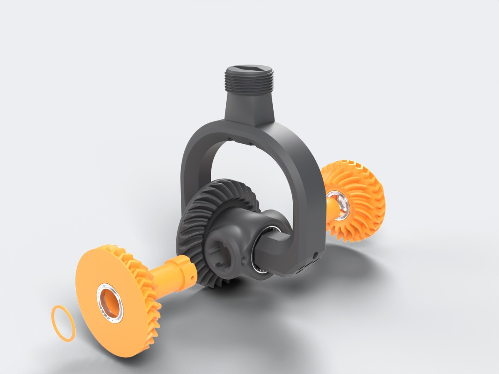

- Push the two `Hub_Axis` shafts into the sides of the `Gear_Hub`.
- Slide a side gear on each shaft, with the bevel teeth facing the crown gear, then a `Hub_Spacer`.

### Step 5: Motor block

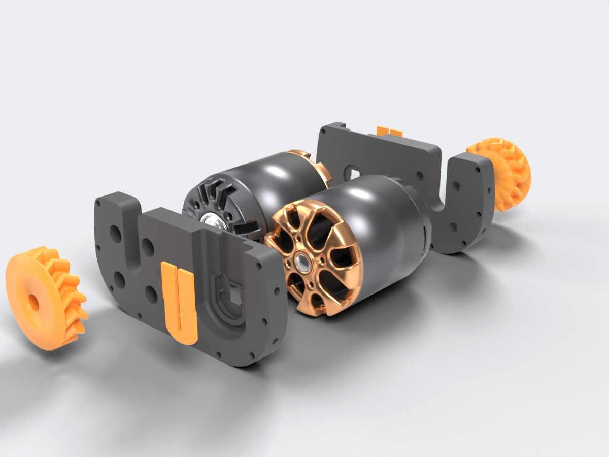

- The two motors sit side by side, head to tail. Screw each motor to the `Motor_Support` on its output side.
- Press a `Motor_Gear` onto each motor shaft, outside the support.
- Glue a diametric magnet on the **rear** end of each motor shaft.
- Place each AS5048A board in the pocket of the opposite support, facing the magnet, and close it with an `AS5048A_Cap`.

### Step 6: Case body

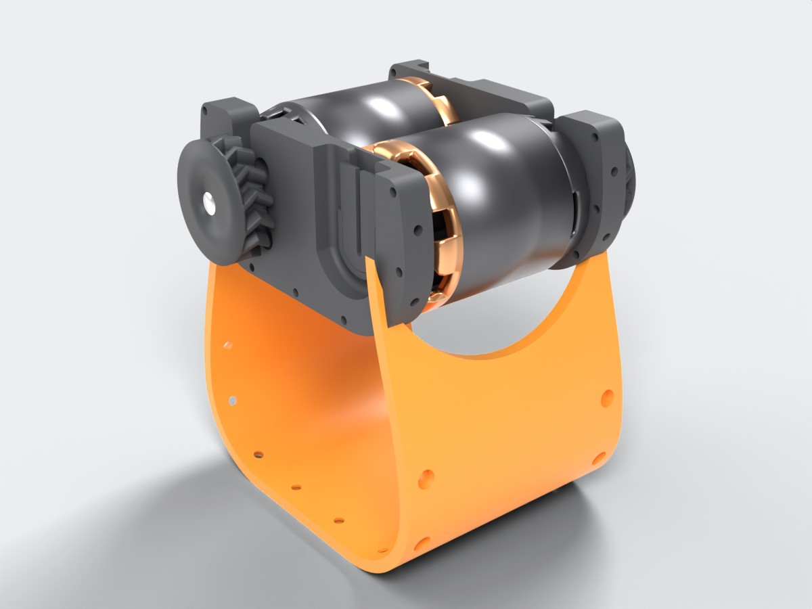

- Lower the motor block into the `Bottom_Panel` and screw the two motor supports to it.
- Route the motor phase wires and the encoder cables to the outside before closing.

### Step 7: Close the case

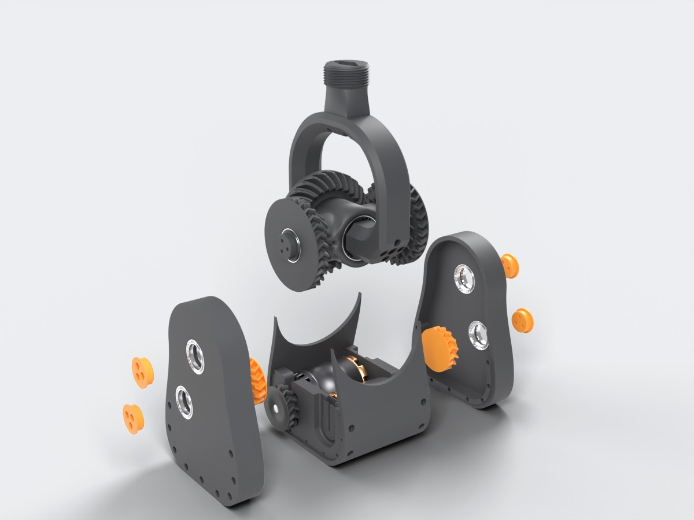

- Lower the differential core into the case.
- Put each `Transmission_Gear` (idler) in place so that it meshes with both the motor gear and the side gear ring.
- Close the case with the two side panels: the carrier shafts and the idler hubs go into the side-panel bearings.
- Fit the four `Axis_Cap`s from the outside and secure each one with 3 screws. Then screw the side panels to the case body.
- Check that the stick moves freely on both axes before you power anything.

### Step 8: Wiring, configuration and grip

- Wire the motors, encoders, brake resistor and power supply (see the next section).
- Configure and calibrate the ODrive.
- Screw your grip onto the adapter.

  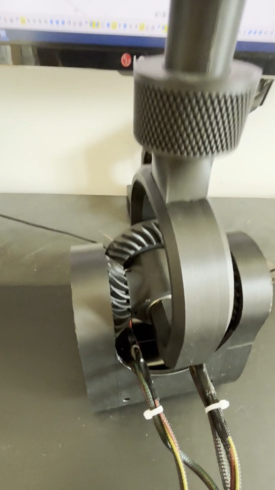
  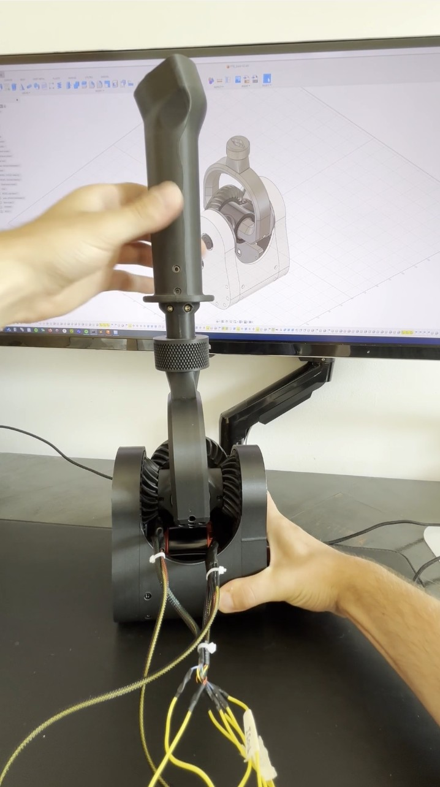
  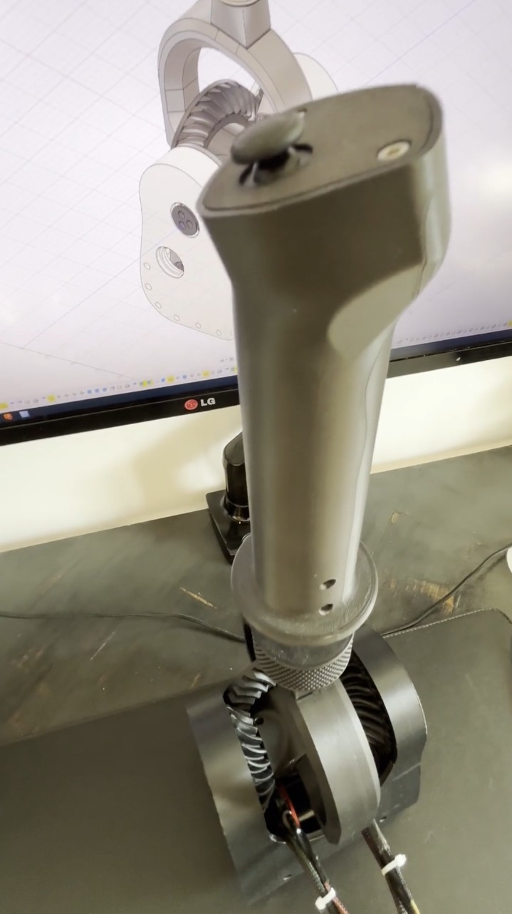

## 🔌 Electronics and ODrive setup

| From | To (MKS XDrive / ODrive v3.6) |
|---|---|
| Motor A phases | M0 |
| Motor B phases | M1 |
| Encoder A: VDD 3.3 V, GND, CLK, MISO, MOSI | 3.3 V, GND, SCK, MISO, MOSI |
| Encoder A: CSn | GPIO 8 (axis 0) |
| Encoder B: same bus, CSn | GPIO 7 (axis 1) |
| Brake resistor | AUX |
| Power supply | DC input |

The configuration is a list of `odrivetool` commands:
[`firmware/odrive/odrive_config_as5048a.txt`](firmware/odrive/odrive_config_as5048a.txt).
The full walkthrough (each parameter, calibration order, tips for torque mode) is in
[docs/electronics-and-odrive.md](docs/electronics-and-odrive.md).

## 📜 License

- **Hardware** (STL, STEP, images and documentation):
  [CC BY-NC-SA 4.0](https://creativecommons.org/licenses/by-nc-sa/4.0/). You can share and remix it
  for non-commercial use, with attribution, under the same license. See [LICENSE](LICENSE).
- **Code and configuration** (`firmware/`): [MIT](firmware/LICENSE).
