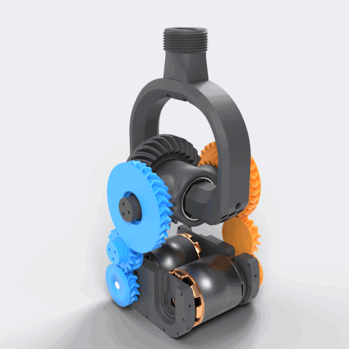

# How it works

[← Back to the README](../README.md)

<p align="center">
  
</p>

## The idea

A classic force feedback gimbal stacks two motors: the second motor is carried by the first axis.
This base uses a **bevel-gear differential** instead:

- both motors are **fixed** in the base, so the moving parts stay light;
- each motor drives one **side bevel gear**, and both side gears mesh with a **crown gear** that carries the grip;
- the **sum** of the two side-gear rotations tilts the whole carrier (**pitch**), and the **difference** spins the crown gear (**roll**).

The same principle is used in robot wrists and in car differentials.

## Gear train

Each side has the same chain:

```
BLDC motor ─ 15T Motor_Gear ─ 15T Transmission_Gear (idler) ─ 30T ring of the Small_Gear
                                                                     │
                                                       20T spiral bevel of the Small_Gear
                                                                     │
                                                    60T spiral bevel Big_Gear (crown, grip)
```

| Stage | Teeth | Ratio |
|---|---|---|
| Motor gear → idler | 15 → 15 | 1:1 (the idler only transmits the motion) |
| Idler → side gear ring | 15 → 30 | 2:1 |
| Side bevel → crown bevel | 20 → 60 | 3:1 (roll only) |

The tooth counts were measured on the CAD model.

## Kinematics

Notation:

- `θ₁`, `θ₂`: the angles of the two side gears' motors, both measured around the pitch axis in the
  **same** rotation direction (one motor is mounted head to tail, so one sign may need to be flipped
  in software);
- `i = 2`: motor-to-side-gear reduction;
- `ρ = 60 / 20 = 3`: crown-to-side bevel ratio.

**From the motors to the stick** (what you need to report the stick position):

```
side gears:  α₁ = θ₁ / i        α₂ = θ₂ / i
pitch     =  (α₁ + α₂) / 2      = (θ₁ + θ₂) / 4
roll      =  (α₁ − α₂) / (2ρ)   = (θ₁ − θ₂) / 12
```

**From the stick to the motors** (what you need to command a position):

```
θ₁ = i · (pitch + ρ · roll) = 2 · pitch + 6 · roll
θ₂ = i · (pitch − ρ · roll) = 2 · pitch − 6 · roll
```

So the stick moves 1° in pitch for 2° of motor rotation, and 1° in roll for 6° of motor rotation.

## Torque and force feedback mixing

By the principle of virtual work, without friction:

```
τ_pitch = i · (τ₁ + τ₂)       = 2 · (τ₁ + τ₂)
τ_roll  = i · ρ · (τ₁ − τ₂)   = 6 · (τ₁ − τ₂)
```

To render a force feedback effect, compute the wanted stick torques, then split them between the
motors:

```
τ₁ = ( τ_pitch / i + τ_roll / (i·ρ) ) / 2 = τ_pitch / 4 + τ_roll / 12
τ₂ = ( τ_pitch / i − τ_roll / (i·ρ) ) / 2 = τ_pitch / 4 − τ_roll / 12
```

Things to keep in mind:

- **Both axes share the torque budget.** With `|τ₁|, |τ₂| ≤ τmax`, the reachable stick torques
  form a diamond: `|τ_pitch| / 4 + |τ_roll| / 12 ≤ τmax`. When an effect asks for more, scale
  both axes down together, so the force keeps the right direction. Clipping each motor separately
  would bend the direction of the force.
- **Order of magnitude.** A 5065 140 KV motor has `Kt ≈ 8.27 / 140 ≈ 0.059 N·m/A`. At the 8 A limit of
  the provided configuration, one motor gives ≈ 0.47 N·m, so the stick gets up to ≈ 1.9 N·m in pitch
  and ≈ 5.7 N·m in roll, before friction losses.
- **Resolution.** The 14-bit AS5048A gives 16384 counts per motor turn, so ≈ 0.011° per count in
  pitch and ≈ 0.004° in roll.
- **Absolute position.** The encoders are absolute over **one motor turn**. Each motor travels
  `2·|pitch| + 6·|roll|`. If the full stick range makes a motor travel more than one turn, the
  position at power-up is ambiguous and you need a homing procedure. For example, ±20° on both axes
  needs 2 × (40° + 120°) = 320° of motor travel, so it still fits in one turn.

## Moving parts

| Moves with… | Parts |
|---|---|
| Nothing (fixed) | Side panels, bottom panel, motor supports, motors' stators, axis caps |
| Motor 1 / motor 2 | Motor gear, idler, side gear (each side on its own) |
| Pitch | Gear hub (carrier), hub axes, crown gear, grip holder |
| Roll | Crown gear and grip holder (inside the carrier, on 2 × 6805 bearings) |
